# DSO202 Practical 06: Helm Chart Deployment and Management

## 1. Introduction

This practical demonstrates how to package and manage a Kubernetes application using Helm. A Helm chart was created for a simple static web page served by Nginx. The chart supports separate development and production configurations, making it possible to deploy the same application with different settings.

The practical covered preparing the Kubernetes environment, creating chart templates, validating and rendering manifests, deploying the application, testing the releases, upgrading and rolling back a release, inspecting values and manifests, and packaging the chart.

## 2. Objectives

The objectives of this practical were to:

- Prepare and verify the Kubernetes and Helm environment.
- Create a reusable Helm chart for a static Nginx web application.
- Configure development and production values.
- Validate the chart and render Kubernetes manifests before deployment.
- Deploy and verify the development and production releases.
- Access the web pages using port forwarding.
- Run Helm test hooks.
- Practise Helm upgrade and rollback operations.
- Inspect release values and rendered Kubernetes resources.
- Package the chart and verify the generated archive.

## 3. Environment Preparation

The working directory was created for Practical 06, and the Kubernetes cluster and Helm installation were checked before starting the implementation. The practical was carried out from PowerShell on Windows using the `kind-dso202` Kubernetes context.

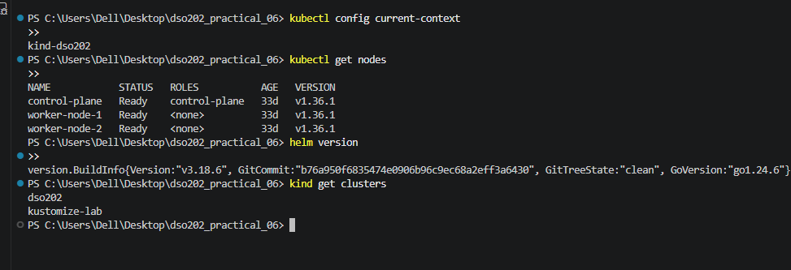

The environment was checked to ensure that the required tools and Kubernetes context were available before creating the chart.

## 4. Creating the Helm Chart Structure

A Helm chart named `webapp` was created. The chart contains metadata, default values, a schema for validating values, helper templates, and Kubernetes resource templates.

The project structure included:

```text
dso202_practical_06/
├── environments/
│   ├── dev.yaml
│   └── prod.yaml
└── webapp/
    ├── Chart.yaml
    ├── values.yaml
    ├── values.schema.json
    ├── .helmignore
    ├── charts/
    └── templates/
        ├── _helpers.tpl
        ├── configmap.yaml
        ├── deployment.yaml
        ├── service.yaml
        ├── NOTES.txt
        └── tests/
            └── test-connection.yaml
```

The chart metadata in `Chart.yaml` identifies the chart as `webapp`, version `0.1.0`, with application version `1.30-alpine`. The template files define the ConfigMap, Deployment, Service, helper functions, release notes, and a Helm test.

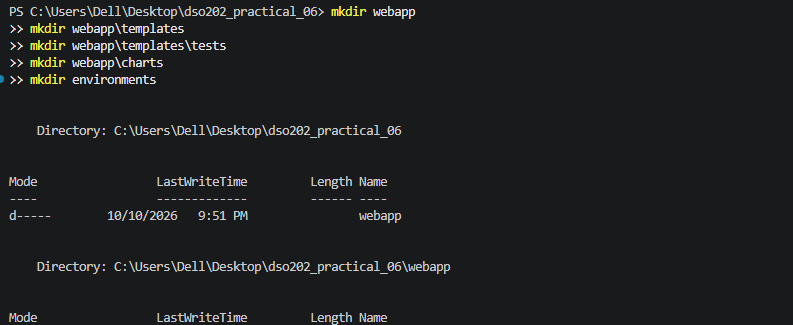

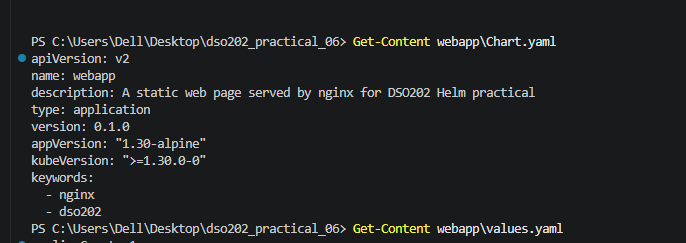

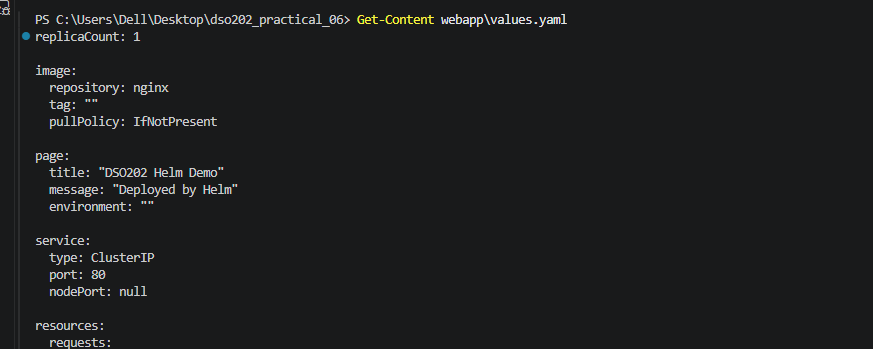

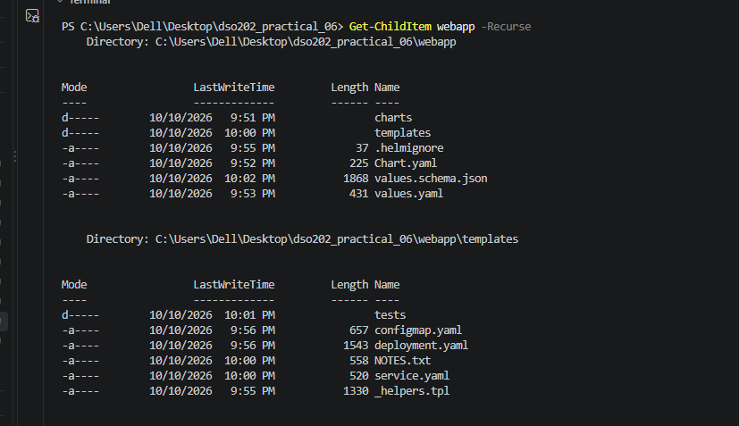

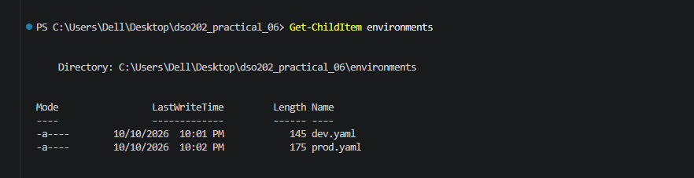

### 4.1 Purpose of the main chart files

| File | Purpose |
| --- | --- |
| `Chart.yaml` | Defines the chart name, chart version, application version, and metadata. |
| `values.yaml` | Defines default settings such as replicas, image, page content, service, resources, and labels. |
| `values.schema.json` | Defines the expected structure and types of chart values. |
| `_helpers.tpl` | Provides reusable template helpers for naming and labels. |
| `configmap.yaml` | Stores the HTML page content that Nginx serves. |
| `deployment.yaml` | Defines the Nginx Deployment, replicas, probes, resource settings, and ConfigMap mount. |
| `service.yaml` | Exposes the application through a Kubernetes Service. |
| `NOTES.txt` | Displays useful information after a Helm installation or upgrade. |
| `tests/test-connection.yaml` | Defines a Helm test Pod that checks the web application response. |
| `environments/dev.yaml` | Overrides the default values for the development release. |
| `environments/prod.yaml` | Overrides the default values for the production release. |

## 5. Validating the Chart Before Deployment

Before installing the application, `helm lint` was used to check the chart for common structural and template problems.

```powershell
helm lint .\webapp -f .\environments\dev.yaml
helm lint .\webapp -f .\environments\prod.yaml
```

Both lint checks completed successfully, with zero chart failures. Helm displayed an informational recommendation that an icon could be added to `Chart.yaml`; this was not a validation failure.

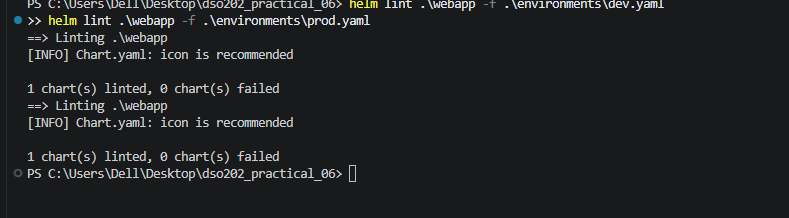

## 6. Rendering Development and Production Manifests

The `helm template` command was used to render the Kubernetes manifests locally before deployment. This made it possible to inspect the resources and confirm how the selected values were applied.

### 6.1 Development manifest rendering

The development values configure the application for development use, including the development page message and a NodePort service. The NodePort was set to `30081` because port `30080` was already being used by another service in the cluster.

```powershell
helm template webapp-dev .\webapp -f .\environments\dev.yaml
```

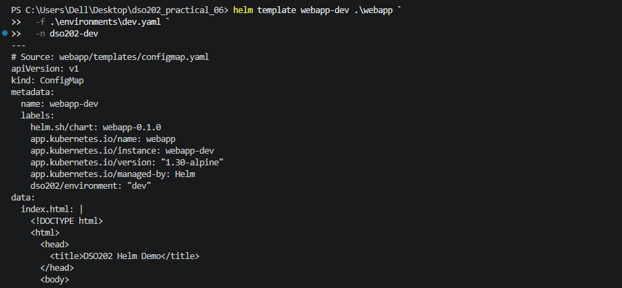

### 6.2 Production manifest rendering

The production configuration uses three replicas and a ClusterIP service. It also defines production-specific page content and resource settings.

```powershell
helm template webapp-prod .\webapp -f .\environments\prod.yaml
```

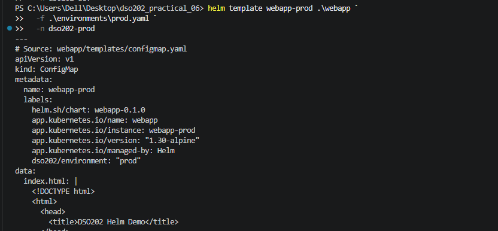

## 7. Checking Kubernetes Namespaces

The namespaces were checked before deploying the application. Separate namespaces were used to keep development and production resources isolated.

- `dso202-dev` — development environment.
- `dso202-prod` — production environment.

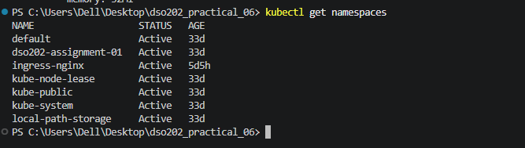

## 8. Installing the Development Application

The development release was installed using the development values file. The `--create-namespace` option creates the namespace if it does not already exist, while `--wait` waits for the resources to become ready.

```powershell
helm upgrade --install webapp-dev .\webapp `
  -f .\environments\dev.yaml `
  -n dso202-dev `
  --create-namespace `
  --wait `
  --timeout 3m
```

The development release was deployed successfully. The development configuration uses one replica and the page displays the development message and environment name.

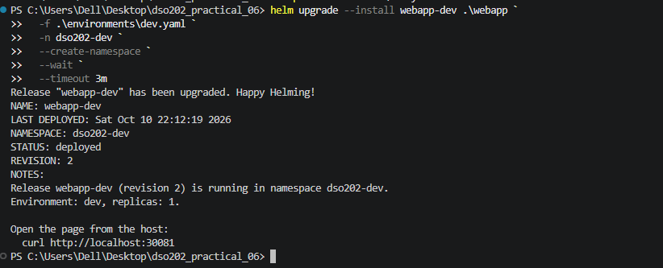

## 9. Verifying the Development Deployment

The ConfigMap, Service, Deployment, and Pods were inspected to verify that the release created the expected resources.

```powershell
kubectl get configmap,service,deployment,pods -n dso202-dev
kubectl rollout status deployment/webapp-dev -n dso202-dev
```

The development Deployment reached the ready state with one available replica.

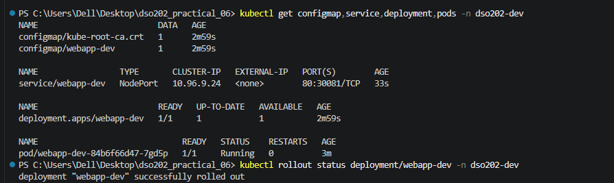

## 10. Accessing the Development Website

Port forwarding was used to access the service locally. In this environment, port `18080` was used because forwarding to local port `8080` was blocked by Windows.

```powershell
kubectl port-forward service/webapp-dev 18080:80 -n dso202-dev
```

While the port-forward command remained running in its terminal, the website was requested from another PowerShell terminal:

```powershell
curl.exe http://127.0.0.1:18080
```

The returned HTML showed the page title, development message, environment, release name, namespace, chart version, and application version.

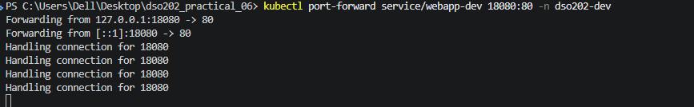

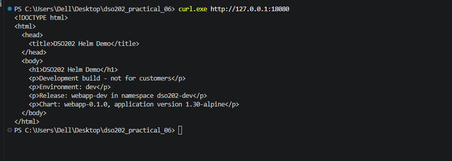

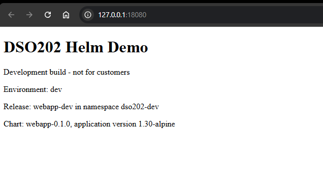

## 11. Running the Development Helm Test

The Helm test was run to check the deployed application using the test Pod defined in the chart.

```powershell
helm test webapp-dev -n dso202-dev --timeout 2m
```

The test suite `webapp-dev-test-connection` completed with the phase `Succeeded`, confirming that the test passed.

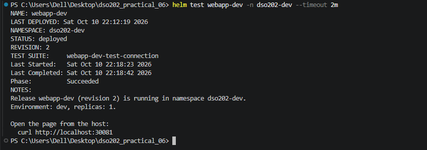

## 12. Checking Development Pods

The Pods were checked to confirm that the application was running in the development namespace.

```powershell
kubectl get pods -n dso202-dev
```

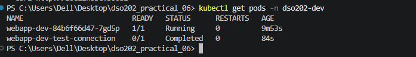

## 13. Deploying the Production Environment

The same chart was installed as a separate production release using `environments/prod.yaml`.

```powershell
helm upgrade --install webapp-prod .\webapp `
  -f .\environments\prod.yaml `
  -n dso202-prod `
  --create-namespace `
  --wait `
  --timeout 3m
```

The production release was deployed successfully with three replicas.

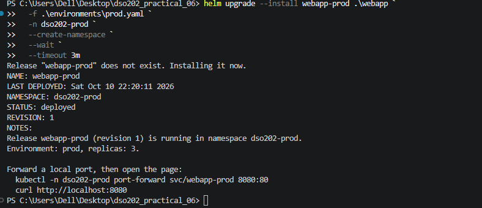

## 14. Verifying Production Resources and Rollout

The production resources and Deployment rollout were checked to ensure that the configured replicas became ready.

```powershell
kubectl get configmap,service,deployment,pods -n dso202-prod
kubectl rollout status deployment/webapp-prod -n dso202-prod
```

The production Deployment reached `3/3` ready replicas.

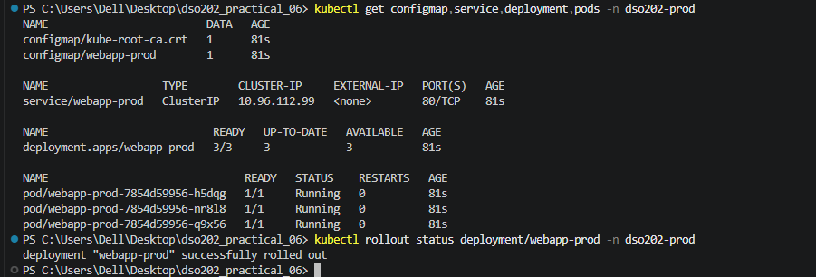

## 15. Accessing the Production Website

The production service was accessed through port forwarding. The port-forward process must remain running while the local address is used.

```powershell
kubectl port-forward service/webapp-prod 18081:80 -n dso202-prod
```

In another PowerShell terminal, the production page can be requested using:

```powershell
curl.exe http://127.0.0.1:18081
```

The production page uses the production-specific content and identifies the environment as `prod`.

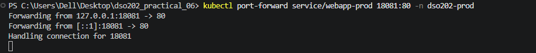

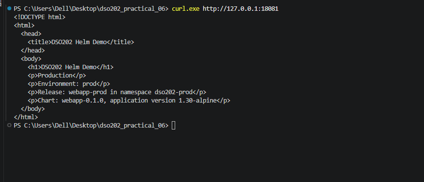

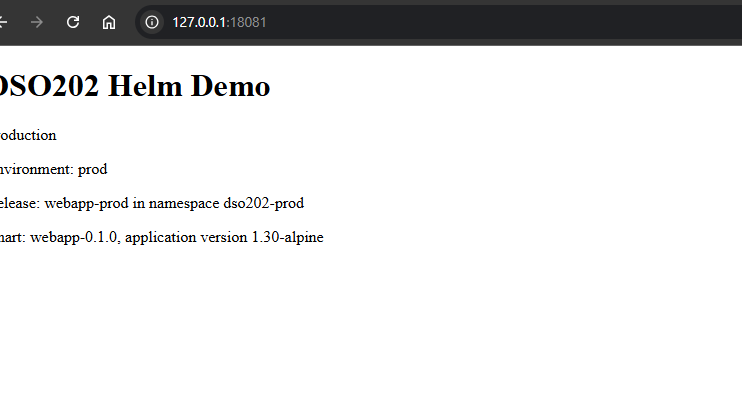

## 16. Comparing the Two Helm Releases

The releases were compared to confirm that the same chart could be installed independently with different configuration values.

```powershell
helm list -A
kubectl get deployments -n dso202-dev
kubectl get deployments -n dso202-prod
```

The verified release information was:

| Setting | Development | Production |
| --- | --- | --- |
| Helm release | `webapp-dev` | `webapp-prod` |
| Namespace | `dso202-dev` | `dso202-prod` |
| Replica count | 1 | 3 |
| Service type | NodePort | ClusterIP |
| Page environment | `dev` | `prod` |
| Release status | Deployed | Deployed |

The development NodePort was configured as `30081` to avoid the existing cluster port conflict.

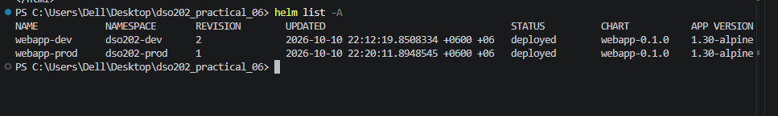

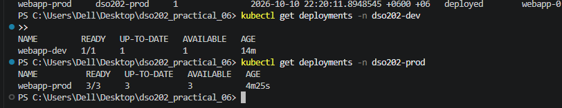

## 17. Running the Helm Tests

The development and production test suites were run separately.

```powershell
helm test webapp-dev -n dso202-dev --timeout 2m
helm test webapp-prod -n dso202-prod --timeout 2m
```

Both test suites completed with the phase `Succeeded`.

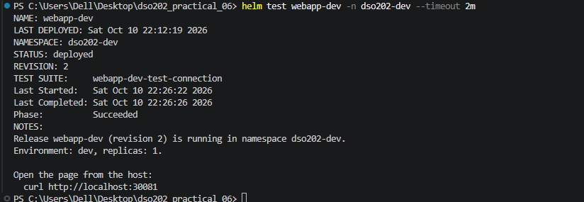

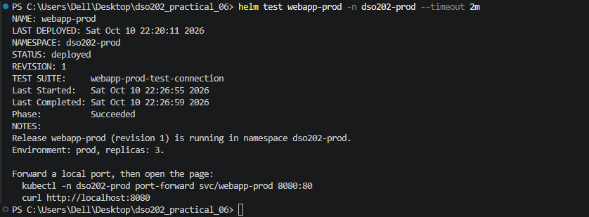

## 18. Practising a Helm Upgrade

A Helm upgrade was practised by changing the development release configuration. The following command sets the development replica count to two for the upgrade exercise:

```powershell
helm upgrade webapp-dev .\webapp `
  -f .\environments\dev.yaml `
  -n dso202-dev `
  --set replicaCount=2 `
  --wait
```

The `--set` option overrides the replica count for this upgrade without changing the base values file.

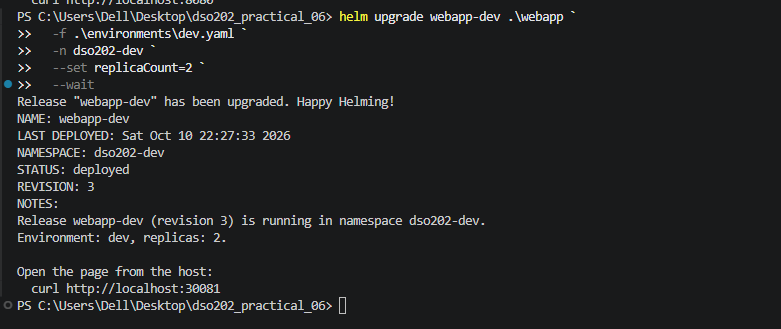

## 19. Verifying the Upgrade

After the upgrade, the Deployment and release history were checked.

```powershell
kubectl get deployments,pods -n dso202-dev
helm history webapp-dev -n dso202-dev
```

The release history records each successful upgrade or rollback as a revision.

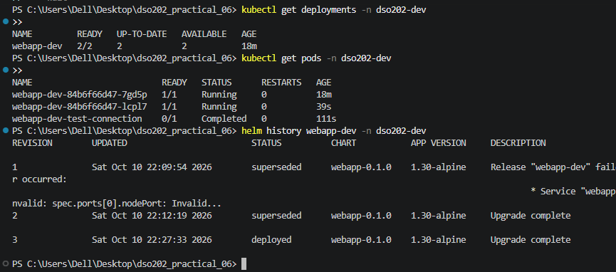

## 20. Practising Helm Rollback

A rollback was practised to restore an earlier release configuration. The revision history was inspected to select revision 2.

```powershell
helm history webapp-dev -n dso202-dev
helm rollback webapp-dev 2 -n dso202-dev --wait
```

Helm records the rollback as a new revision. In the completed practical, the development release history showed revision 4 with the description `Rollback to 2`.

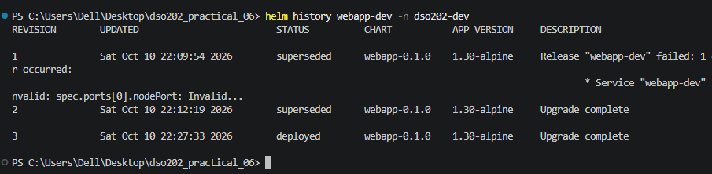

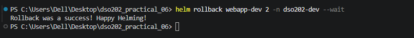

## 21. Verifying the Rollback

After rollback, the release history and Deployment were checked again to confirm the restored state.

```powershell
helm history webapp-dev -n dso202-dev
kubectl get deployments -n dso202-dev
```

The verified development release was revision 4, and the Deployment had one ready replica (`1/1`).

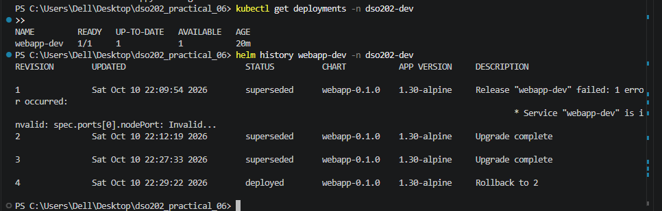

## 22. Inspecting Helm Values and Manifests

Helm commands were used to inspect the values and Kubernetes manifests associated with the development release.

### 22.1 Inspecting user-supplied values

```powershell
helm get values webapp-dev -n dso202-dev
```

This command displays values supplied to the release.

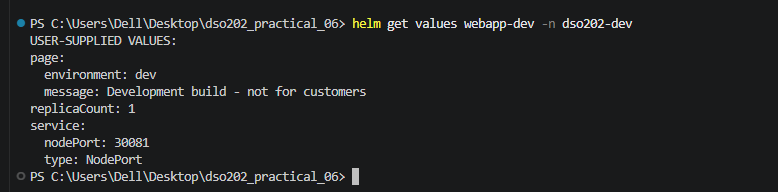

### 22.2 Showing all computed values

```powershell
helm get values webapp-dev -n dso202-dev --all
```

The `--all` option includes the computed values, including chart defaults and overrides.

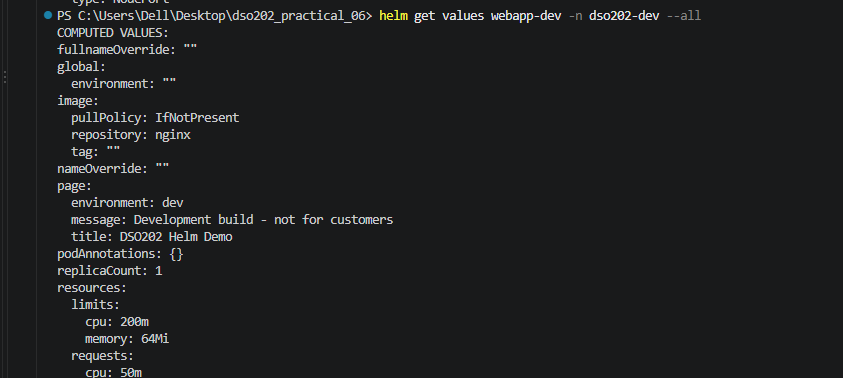

### 22.3 Inspecting the Kubernetes manifests

```powershell
helm get manifest webapp-dev -n dso202-dev
```

This command displays the Kubernetes manifests managed by the Helm release.

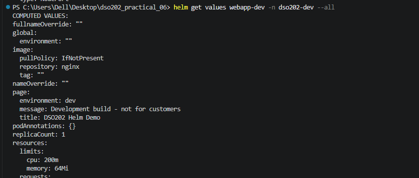

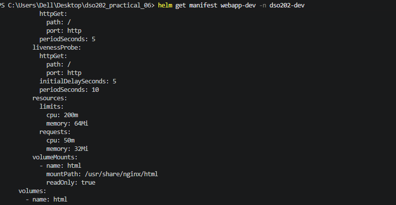

## 23. Packaging the Helm Chart

After validation and deployment exercises, the chart was packaged into a versioned archive.

```powershell
helm lint .\webapp -f .\environments\dev.yaml
helm lint .\webapp -f .\environments\prod.yaml
helm package .\webapp
```

Both lint checks passed, and Helm successfully created:

```text
webapp-0.1.0.tgz
```

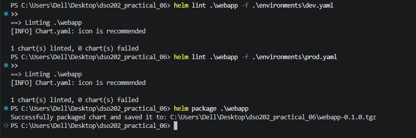

## 24. Inspecting the Packaged Chart

The chart metadata and default values in the packaged archive were inspected.

```powershell
helm show chart .\webapp-0.1.0.tgz
helm show values .\webapp-0.1.0.tgz
```

The metadata confirmed the chart name `webapp`, chart version `0.1.0`, application version `1.30-alpine`, and the Kubernetes version constraint.

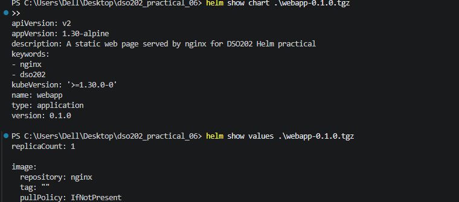

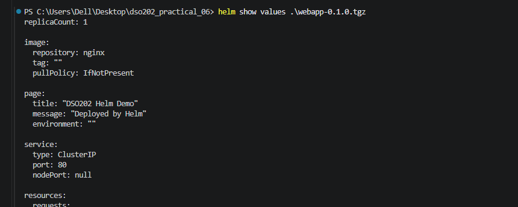

## 25. Final Verification

The final release list and Deployment states were checked.

```powershell
helm list -A
kubectl get deployments -n dso202-dev
kubectl get deployments -n dso202-prod
```

The final verification showed:

- `webapp-dev` was deployed in namespace `dso202-dev`, with one ready replica.
- `webapp-prod` was deployed in namespace `dso202-prod`, with three ready replicas.
- Both Helm test suites succeeded.
- Both development and production chart lint checks passed.
- The chart package `webapp-0.1.0.tgz` was created and its metadata was inspected.

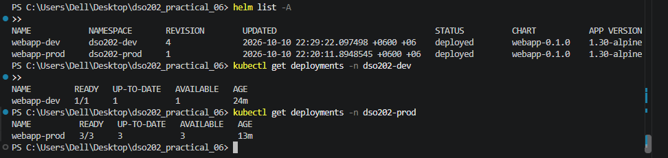

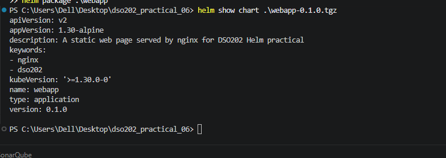

## 26. Challenges and Solutions

| Challenge | Solution |
| --- | --- |
| The development NodePort `30080` was already in use by another service. | The development configuration was changed to use NodePort `30081`. |
| Port forwarding to local port `8080` was blocked on Windows. | An alternative local port, `18080`, was used for development access. |
| The chart produced an informational warning about a missing icon. | The warning was noted; it did not prevent linting or packaging. |

## 27. Conclusion

This practical demonstrated how Helm simplifies the deployment and management of Kubernetes applications. A reusable chart was created and configured for separate development and production environments. The chart was validated and rendered before deployment, and both releases were installed and verified. The web pages were accessed through port forwarding, and the Helm test suites completed successfully.

The practical also covered release comparison, upgrade, rollback, value and manifest inspection, and chart packaging. The final chart archive, `webapp-0.1.0.tgz`, was generated and inspected successfully.

